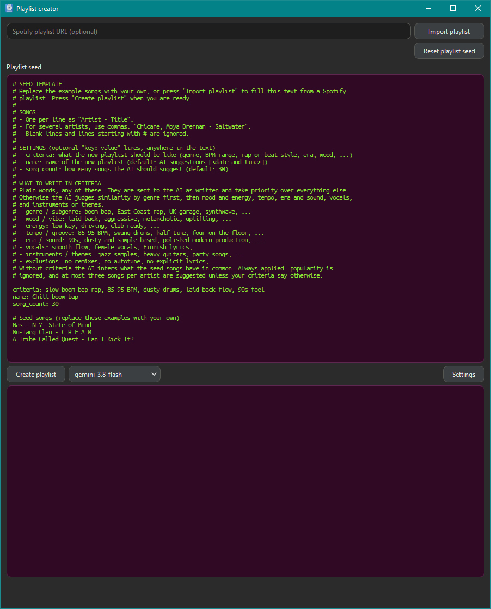

# Spotify Tools

## Introduction

Two tools that create private Spotify playlists:

- **Winamp to Spotify** converts old Winamp playlist exports (`.htm`, `.html`, `.txt`) into Spotify playlists. Each export is cleaned into a plain list of "Artist Title" lines, every line is searched on Spotify, and the best matches go into a new playlist.
- **Playlist creator** asks Google Gemini for songs similar to a set of seed songs, based on criteria you write (genre, BPM, beat or rap style, mood, ...). Every suggestion is looked up on Spotify, so invented songs are dropped, and the matches go into a new playlist. The seed songs themselves are never suggested, and a playlist never contains the same song twice.
  - Gemini chooses the songs from its own knowledge of music. Spotify's recommendations, audio data and your listening history are not used; Spotify is only searched to check that each suggested song exists.
  - Gemini is told to weigh, in this order: your criteria, genre and subgenre, energy level, tempo and groove, era and production, vocals, instrumentation and lyrical themes. Without criteria, it infers what the seed songs have in common.
  - Popularity is not a factor, so deep cuts are as likely as hits. Original studio versions are preferred over live versions and covers, and there are at most three songs per artist, unless your criteria say otherwise.
  - Suggested songs that Spotify cannot match are skipped, so the playlist can end up with fewer songs than requested.

Both tools use the Spotify Web API through `spotipy`, with the shared helpers in `modules/spotify_api.py`. Every run writes a log (see [Logs](#logs)).



## Table of Contents

- [Installation](#installation)
  - [Spotify](#spotify-spotify-developer-dashboard)
    - [Sharing one Spotify app with other users](#sharing-one-spotify-app-with-other-users)
  - [Gemini](#gemini-google-ai-studio)
- [GUI installer](#gui-installer)
- [Usage](#usage)
  - [Winamp to Spotify](#winamp-to-spotify)
  - [Playlist creator](#playlist-creator)
    - [Where the seed songs come from](#where-the-seed-songs-come-from)
    - [Creating the playlist](#creating-the-playlist)
    - [GUI](#gui)
      - [Desktop shortcut (Windows)](#desktop-shortcut-windows)
- [How songs are matched](#how-songs-are-matched)
- [Logs](#logs)
- [Notes and limits](#notes-and-limits)
- [License](#license)

## Installation

These steps set up the command-line tools and the GUI from source. For the GUI only, see the [GUI installer](#gui-installer).

1. Create the conda environment `spotify_tools` from the project root. It installs Python 3.13 and then installs the project and all its dependencies (listed in `pyproject.toml`) with pip:

   ```powershell
   conda env create -f environment.yml
   conda activate spotify_tools
   ```

2. Set up Spotify and Gemini as described below.
3. Put the credentials into the file `.spotipy` in your user folder (`%USERPROFILE%\.spotipy`), one `key=value` per line. The GUI's **Settings** button writes the same file.

   ```text
   CLIENT_ID=<Spotify client id>
   CLIENT_SECRET=<Spotify client secret>
   GEMINI_API_KEY=<Gemini API key>
   ```

   - `CLIENT_ID`: the Client ID of your Spotify app, see [Spotify](#spotify-spotify-developer-dashboard).
   - `CLIENT_SECRET`: the Client secret of the same Spotify app. Keep it private.
   - `GEMINI_API_KEY`: your Google AI Studio API key, see [Gemini](#gemini-google-ai-studio). Only the Playlist creator needs it.

4. Run every command from the project root (the folder that contains `modules`), using `python -m ...` as shown below.

### Spotify (Spotify Developer Dashboard)

Both tools need a Spotify app to get a client ID and secret.

1. Log in at the [Spotify Developer Dashboard](https://developer.spotify.com/dashboard) with your Spotify account.
2. Click **Create app**, enter any name and description, accept the Developer Terms of Service and, if asked which APIs you plan to use, choose **Web API**.
3. Add this exact **Redirect URI** and save: `http://127.0.0.1:8888/callback`.
4. Open the app's **Settings** and copy the **Client ID** into `CLIENT_ID` and the **Client secret** into `CLIENT_SECRET` in `.spotipy`.
5. The app stays in Development Mode, which is enough for your own account. It has limits on users and requests.

On the first run, a browser window opens and asks you to approve access. The tools ask for permission to read, create and edit your private playlists (`playlist-read-private` and `playlist-modify-private`). If, after you approve, the browser shows an error page such as "This site can't be reached", copy the full address from the browser's address bar (it starts with `http://127.0.0.1:8888/callback`) and paste it into the terminal where you started the command, at the prompt asking for the redirect URL, then press Enter. spotipy keeps the login in a `.cache` file in the project folder, so keep that file private too.

If you change `CLIENT_ID` to a different Spotify app, delete the `.cache` file before the next run. The saved login belongs to the old app, and Spotify rejects it with `invalid_client`. Changing the Client ID in the GUI's **Settings** deletes the file for you.

#### Sharing one Spotify app with other users

Other people can use your app's `CLIENT_ID` and `CLIENT_SECRET`. Each of them logs in with their own Spotify account, and the playlists are created in that account. They get no access to your account, only to their own playlists.

- In the dashboard, add each user under **User Management** with the email of their Spotify account. A Development Mode app allows 5 users, and anyone not on the list gets a 403 error.
- The app owner needs an active Spotify Premium subscription; the other users do not.
- Share the client secret only with people you trust. If it leaks, reset it in the dashboard and update `CLIENT_SECRET` for everyone.
- Anyone who needs more than that can create their own Spotify app instead.

### Gemini (Google AI Studio)

Gemini is only needed for the Playlist creator, not for Winamp to Spotify.

1. Open [Google AI Studio](https://aistudio.google.com/apikey) and sign in with a Google account.
2. Click **Create API key** (AI Studio creates a Google Cloud project for you the first time).
3. Copy the key into `.spotipy` as `GEMINI_API_KEY`.

Google may use free-tier content to improve its products, and the seed songs and criteria are what gets sent. The free tier has rate limits, including a small number of requests per day for each model; how the Playlist creator handles models and quota is described under [Creating the playlist](#creating-the-playlist).

## GUI installer

The Playlist creator GUI is also available as a 64-bit Windows installer, so no Python or conda is needed. The command-line tools, including Winamp to Spotify, are not part of it. Get the installer from [GitHub releases](https://github.com/herbook/spotify_tools/releases); please do not redistribute it.

- It installs for the current user only, so it needs no administrator rights. The default folder is `%LOCALAPPDATA%\Programs\PlaylistCreator`, and you can choose another folder that you can write to. A Start Menu shortcut and a Desktop shortcut are optional steps in the installer.
- Set up Spotify and Gemini as described above, then enter the keys under **Settings**. They are saved in `%USERPROFILE%\.spotipy`, as in the conda setup.
- Everything else stays in the install folder: the logs in `log` and the Spotify login in `.cache` (keep that file private). The app installed this way has no terminal, so the paste-the-address fallback described under [Spotify](#spotify-spotify-developer-dashboard) is not available.
- To update, run the newer installer and keep the same folder; the logs are kept. The uninstaller always removes `.cache` and asks whether to delete `log` and `seeds` if they exist.

## Usage

### Winamp to Spotify

Both steps take the folder that holds your Winamp exports as an argument, for example `C:\Music\playlists`.

1. **Clean the exports.** This reads every file in that folder, removes numbering, durations, file extensions and duplicates, and writes one `<name>_<ext>_fixed.txt` per file (for example `playlist_htm_fixed.txt`) into a `fixed` subfolder. Check these files and fix them by hand if needed.

   ```powershell
   python -m modules.winamp_to_spotify.playlist_parser <folder>
   ```

2. **Create the playlists.**
   - If all cleaned files in the `fixed` subfolder together have fewer than 10,000 songs (Spotify's limit per playlist), one private playlist `Winamp imports [all files] <time>` is created with the songs of all files, and a song that appears in several files is added once. `<time>` is the same `YYYYMMDD_HHMM` as in the log file names.
   - Otherwise, a private playlist `Winamp imports [<name>_<ext>_fixed] <time>` is created for each file, and duplicates are dropped within each file.
   - A song is added only if Spotify has a close enough match. To leave a file out, move it out of the `fixed` subfolder first.

   ```powershell
   python -m modules.winamp_to_spotify.winamp_to_spotify <folder>
   ```

### Playlist creator

The Playlist creator works from a **seed file**: a plain text file in the `seeds` folder with one `Artist - Title` per line and optional settings. The format is explained in `seeds/templates/seed_template.txt`:

```text
criteria: slow boom bap rap, 85-95 BPM, dusty drums, laid-back flow, 90s feel
name: Chill boom bap
song_count: 30

Nas - N.Y. State of Mind
Wu-Tang Clan - C.R.E.A.M.
```

- Lines starting with `#` and blank lines are ignored.
- `criteria` tells the AI what the new playlist should be like. Without it, the AI infers what the seed songs have in common.
- `name` is the new playlist's name (default `AI suggestions [<Spotify playlist name>] <date and time>` for a seed exported from Spotify, otherwise `AI suggestions [<date and time>]`).
- `song_count` is how many songs to suggest (default 30).
- For several artists, use commas, for example `Chicane, Moya Brennan - Saltwater`.

#### Where the seed songs come from

There are two ways to get a seed file. In both, the `criteria`, `name` and `song_count` settings are optional, and you can set them in the file or with the command-line options.

1. **From a Spotify playlist, or part of one.** Export the playlist into a seed file, edit the file if you like (remove songs, add `criteria:`), then run `suggest_playlist` on it. You can use a playlist link, URI or ID. Apps created since February 2026 can only read the songs of playlists you own or collaborate on, and the export fails with a 403 error for any other playlist. To use someone else's playlist, add its songs to a playlist of your own first.

   ```powershell
   python -m modules.playlist_creator.export_playlist_seed <spotify playlist url>
   python -m modules.playlist_creator.suggest_playlist "seeds\<playlist name>.txt"
   ```

   The seed is written to `seeds\<playlist name>.txt`; use `--output <path>` to choose another file. To export only a range of positions (1-based, inclusive), for example the 10 songs that best show the sound you want, add `--start` and `--end`; either can be left out:

   ```powershell
   python -m modules.playlist_creator.export_playlist_seed <spotify playlist url> --start 11 --end 20 --output seeds\sub_set.txt
   ```

2. **From your own list of songs.** Copy `seeds/templates/seed_template.txt` to a new name and replace the three example songs (Nas, Wu-Tang Clan, A Tribe Called Quest) with songs you like. Songs you type yourself work like exported ones. You can also copy lines from several exported seeds into one file, or add a few songs of your own to an exported one. To just try the Playlist creator, keep the example songs and change only the settings. Then create the playlist as described under [Creating the playlist](#creating-the-playlist).

At least one seed song is needed; a seed file with only settings is rejected.

#### Creating the playlist

Once you have a seed file, create the playlist with:

```powershell
python -m modules.playlist_creator.suggest_playlist seeds\my_seed.txt
```

The options `--criteria`, `--song-count`, `--name` and `--model` override the settings in the seed file, for example:

```powershell
python -m modules.playlist_creator.suggest_playlist seeds\my_seed.txt --song-count 50 --criteria "more instrumental, slower" --model gemini-3.5-flash-lite
```

While it runs, the command window shows a live progress counter and any songs that were not found or skipped. At the end it prints the playlist link, Gemini's summary of the playlist, the number of songs added and skipped, and the log path. A request that gets no data for 500 seconds is cancelled and retried.

To get different results from the same seed, run it again with other `--criteria`, `--song-count` or `--model` values, or edit `criteria:` in the file. Each run creates a new playlist and a new log, so rename or delete the ones you don't want in Spotify.

**Models and quota.** The default model is `gemini-3.8-flash`. Only free-tier models are offered, the most powerful first. The GUI's model dropdown lists those that the Gemini API reports for your key; the list is not a guarantee that a model has quota left. When a model's quota is used up or it is no longer available, the next model in the free-tier list is tried, and the output says which one was used (the log shows it too). When none is left, the run stops with a message that says which quota it was and when to retry; every attempt counts, including retries after network errors. If Gemini is overloaded or has a temporary server error, the request is retried a few times with growing delays; if it keeps failing, the run stops with Gemini's error and does not switch to another model.

#### GUI

The Playlist creator also has a GUI, started from the project root:

```powershell
python -m modules.playlist_creator.gui
```

Enter the Spotify and Gemini keys under **Settings** (they are saved in `.spotipy`, the same file the commands read). Paste a playlist URL and press **Import playlist** to fill the seed text with its songs, or type the seed yourself; the text starts as `seeds/templates/seed_template_gui.txt`. **Create playlist** runs the same steps as the command and shows the progress, with a link to the new playlist at the end. While it runs, a spinning LP record is shown; clicking it stops the process. The model is chosen in the dropdown next to **Create playlist** (default `gemini-3.8-flash`), and `criteria`, `name` and `song_count` are set as lines in the seed text. When you start the GUI from source, keep the terminal open: if Spotify's approval page fails to load, the address is pasted there.

##### Desktop shortcut (Windows)

To open the GUI from a desktop icon, run this once from the project root, using the project's Python environment:

```powershell
python -m modules.playlist_creator.create_shortcut
```

It creates `Playlist creator.lnk` on the desktop, which starts the GUI without a console and points at that environment, so run the command again if you move or recreate it. The shortcut has no terminal, so before first using it, start the GUI once from the project root with `python -m modules.playlist_creator.gui` and approve the Spotify sign-in there.

## How songs are matched

Both tools match songs the same way (the code is in `modules/spotify_api.py`). The input is one line per song: `Artist Title` from a cleaned Winamp list, or the artist and title of a Gemini suggestion.

1. **Search.** The line is searched on Spotify as written. The top 10 results are scored from 0 to 1, and the best one is used; when scores tie, Spotify's own order decides.
2. **Artist.** A result counts only if one of its artists is named in the line. Small spelling differences are tolerated (`Chilli` for `Chili`, `Silver Chair` for `Silverchair`), and `the`, `a` and `and` are ignored. Winamp to Spotify is more lenient: one distinctive word of the artist's name is enough (`Cent` finds `50 Cent`), but generic words such as `DJ` and `MC` do not count. A line with only an artist and no title is never added.
3. **Title.** The words left after removing the artist are compared with the track's title only, so a different song by the right artist scores low. Extra words in the line (track numbers, `feat.`, album names) do not lower the score, and suffixes such as `Remastered 2011` or `Radio Edit` are ignored.
4. **Versions.** Karaoke and tribute versions never match. Live, instrumental and cover versions rank slightly below the original.
5. **Remixes.** If the line names a specific remix, such as `Chill Out Mix`, the result should be that remix. Playlist creator rejects a different remix; Winamp to Spotify ranks it below the original recording. The original recording is accepted when the remix is not on Spotify, but it ranks below the requested remix. A plain `Remix` in the line accepts any remix.
6. **Threshold.** A song is added only if its score reaches 0.75 (Playlist creator) or 0.6 (Winamp to Spotify). Winamp to Spotify is more lenient because, for an old playlist, a missing song costs more than a few wrong ones. Songs below the threshold are not added; they are logged as not found with the best candidate and its score.
7. **Duplicates.** Winamp to Spotify treats all versions of a song as the same song. Playlist creator treats a different remix as a different song, but `Original Mix` and remaster labels count as the same song, and the seed songs themselves are never added.

## Logs

Logs are written under `log` in the project folder (in the install folder when you use the installer).

- `log\winamp_to_spotify\`: per playlist created (`all_files` when merged, otherwise per input file), a log of added songs and one of songs that were not found or skipped as duplicates, plus a list of the created playlists with their links.
- `log\playlist_creator\`: `<time>_[<seed name>]_ai_playlist_log.md`, a Markdown table with one row per suggested song: whether it was added or skipped, the song Gemini suggested, what Spotify returned (with a match score from 0 to 1) and Gemini's reason. The header has a link to the created playlist.

Match scores below about 0.9 are worth a look, because Spotify may have returned a different version or remix of the song. Songs that were not added are listed in the not-found logs with their best candidate; see [How songs are matched](#how-songs-are-matched) for the thresholds.

## Notes and limits

- Playlists are created private, and the Spotify API cannot create playlist folders, so move the new playlists into a folder in the Spotify app yourself.
- Lines without an artist, with only an artist and no title, or with a badly misspelled artist end up in the not-found log; see [How songs are matched](#how-songs-are-matched).
- In the Playlist creator, a different remix of a seed song may be suggested and added; the exact seed song is never added. The Winamp import counts all versions of a song as the same song.
- Spotify's Developer Policy prohibits using Spotify content to train or feed machine learning or AI models. Exporting a playlist to a seed and sending its song names to Gemini may fall under that, so check the current [policy](https://developer.spotify.com/policy) before using it beyond personal experiments.
- If Spotify answers with an authorization or rate-limit error (401, 403 or 429), the run stops instead of logging every remaining song as failed.

## License

Copyright (c) 2026 Herman Böök.

This project is under the [PolyForm Strict License 1.0.0](LICENSE). In short, you may use the software for noncommercial purposes (personal use, noncommercial organizations), but you may not distribute it or make changes or new works based on it. Read the license for the exact terms.

Get the latest version from [https://github.com/herbook/spotify_tools](https://github.com/herbook/spotify_tools).
